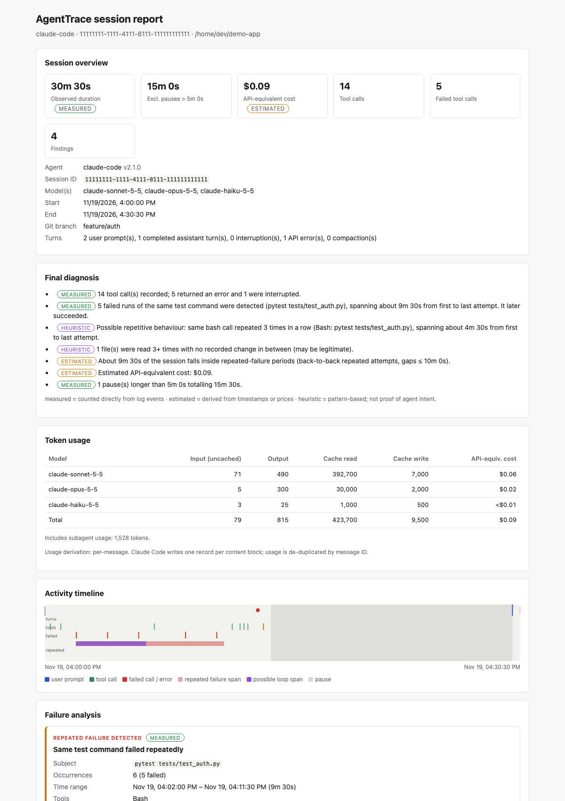

# AgentTrace

**Understand what your AI coding agent did, where it spent resources and what went wrong.**

AgentTrace is a local-first CLI that reads the session logs **Claude Code** and **Codex** already write on your machine and tells you:

- how many tokens each session used (by model and by day) and the **API-equivalent cost**
- how long it took, where the long pauses were, how long tools ran
- which tool calls failed
- **repeated failures**: the same command or test failing again and again
- **possible repetitive behaviour** (loops), always with the evidence

Everything runs offline. Nothing is uploaded, no LLM is used, no API key is needed and the original logs are never modified.



*Example report generated from synthetic test data: [`examples/example-report.html`](examples/example-report.html).*

## Features

- **Two agents, one model.** Claude Code transcripts (including subagents) and Codex rollouts (current, VS Code/app-server and legacy formats, plain or `.jsonl.zst`) are normalized into one session model.
- **Correct token accounting.** Claude splits one API response over several log records with repeated usage; Codex writes cumulative totals, often repeatedly. AgentTrace de-duplicates and uses deltas instead of double counting.
- **Honest numbers.** Every metric is labelled *measured*, *observed*, *estimated* or *heuristic*. Cost is never guessed for unknown models.
- **Failure and loop detection.** Deterministic rules with a configurable threshold, each finding showing occurrences, time range, whether it later succeeded and why it was flagged.
- **Offline HTML reports.** One self-contained file per session: no scripts, no external requests.
- **Fast repeat runs.** A local summary cache makes `analyze --all` and `sessions` re-parse only new or changed logs.
- **Privacy by default.** Prompts, assistant text, file contents and tool output never appear in reports or in the cache.

## Install

Requires **Node.js 22 or newer** (22.15+ to read compressed `.jsonl.zst` Codex logs).

Run it without installing:

```bash
npx @vukkisa/agenttrace analyze --latest
```

Or install it globally (the command is `agenttrace`):

```bash
npm install -g @vukkisa/agenttrace
agenttrace analyze --latest
```

### From source

```bash
git clone https://github.com/Vukkisa/agenttrace.git
cd agenttrace
npm ci
npm run build
npm link            # optional: puts `agenttrace` on your PATH
```

Or run it without linking: `node dist/cli/index.js <command>`.

## Quick start

```bash
agenttrace scan                          # which log folders were found
agenttrace sessions --limit 10           # recent sessions
agenttrace analyze --latest              # analyze the newest session
agenttrace analyze --all                 # totals across all sessions
agenttrace report --latest --out report.html
```

Example output (synthetic data):

```
$ agenttrace analyze --session 11111111
...
  REPEATED FAILURE DETECTED  [measured]  Same test command failed repeatedly
    Subject:     pytest tests/test_auth.py
    Occurrences: 6 (5 failed)
    Time range:  Nov 19, 04:02 PM–Nov 19, 04:11 PM (9m 30s)
    Later success: yes
    Why flagged: The normalized command ran 6 time(s) and returned an error 5 time(s); 1 file modification(s) were recorded in between.
    Recommendation: Inspect the original test failure output before re-running the same test again.
```

## Commands

| Command | What it does |
|---|---|
| `agenttrace scan [--json]` | Show which log directories were found and how many sessions each has |
| `agenttrace sessions [--limit 30] [--json]` | List sessions: agent, ID, start, duration, models, tool calls |
| `agenttrace analyze --session <id>` | Analyze one session (full ID or unique prefix) |
| `agenttrace analyze --latest` | Analyze the most recently modified session |
| `agenttrace analyze --all [--json]` | Totals across all sessions, by model and by day |
| `agenttrace report --session <id> [--out file.html]` | Write an offline HTML report |
| `agenttrace report --latest` | HTML report for the latest session |
| `agenttrace inspect [--session <id>] [--json]` | Parser diagnostics: record-type counts, unsupported records, malformed lines. No content. |
| `agenttrace pricing [--json]` | Show the pricing table in use |
| `agenttrace pricing --init my-prices.json` | Write a template for custom prices |
| `agenttrace cache info` | Show where the cache is and how big it is |
| `agenttrace cache clear` | Delete the cache |
| `agenttrace reports-clean [--dir .] [--yes]` | List / delete generated `agenttrace-report-*.html` files |
| `agenttrace mcp` | Run the local MCP server over stdio (see [Use with Claude Code](#use-with-claude-code-mcp)) |

**Global options:** `--claude-dir <path>`, `--codex-dir <path>`, `--pricing <file>`, `--agent claude-code|codex`, `--no-cache`.

**Detection options** (`analyze`, `report`): `--threshold <n>` (default 3), `--pause-minutes <n>` (default 5), `--show-errors` (include redacted first-line error excerpts; off by default).

## Use with Claude Code (MCP)

`agenttrace mcp` is a local [MCP](https://modelcontextprotocol.io) server over **stdio**. It lets Claude Code (or any MCP client) query your session analysis in chat: *"Why did my last session cost so much?"* Claude calls AgentTrace, AgentTrace reads your local logs, and Claude explains the result. It needs no network, no cloud service and no LLM API key.

> Requires AgentTrace 0.3 or later. Until 0.3 is published to npm, use the "From source" install and point the client at `dist/cli/index.js`.

**Add it to Claude Code**

```bash
claude mcp add agenttrace -- npx -y @vukkisa/agenttrace mcp
```

From a source checkout instead:

```bash
claude mcp add agenttrace -- node /absolute/path/to/agenttrace/dist/cli/index.js mcp
```

Or in a project `.mcp.json`:

```json
{ "mcpServers": { "agenttrace": { "command": "npx", "args": ["-y", "@vukkisa/agenttrace", "mcp"] } } }
```

Global options go before `mcp`, e.g. `agenttrace --claude-dir /other/claude --no-cache mcp`. Then ask in chat, for example:

- "List my recent sessions."
- "Analyze my latest session and tell me where it wasted time."
- "Show the repeated failures in session `1111`."
- "How much did my sessions cost this week, by model?"

**Tools** (all read-only; each returns structured JSON)

| Tool | Inputs | Returns |
|---|---|---|
| `list_sessions` | `agent?`, `limit?` (≤100, default 20), `project?` | Session id, project folder name, start, measured duration, models, tool calls, failed calls, finding count, estimated cost |
| `analyze_session` | `session?` (id or prefix) or `latest` | Tokens, estimated cost, timing, per-tool stats, up to 20 findings (no evidence, no commands) |
| `get_failures` | `session?` or `latest`, `kind?`, `include_commands?`, `max_findings?` | Findings with up to 8 evidence items each: timestamp, tool, status, exit code, error class |
| `cost_summary` | `agent?`, `since?` (`YYYY-MM-DD`), `group_by?` (`model`, `day`, `session`), `limit?` | Token totals and estimated cost, grouped |

**What the MCP server will and won't return**

- **Never** returns prompts, assistant text, tool output, file contents, file lists, working-directory paths or error excerpts. Every response is built from a fixed field allowlist (`src/mcp/sanitize.ts`), and a final check refuses to send a response that contains an absolute path.
- **Command text is off by default.** `get_failures` with `include_commands: true` adds the command for each evidence item, redacted for secrets, with absolute paths shortened to `<path>/name`, on one line and truncated.
- **Limits:** at most 20 findings and 8 evidence items per finding per response.
- **Costs** are *estimated API-equivalent* costs at public list prices, never your bill. They are labelled that way in every response. Per-day grouping returns tokens only, because daily totals are not split by model.
- **Times** carry `kind: "measured"` (from log timestamps) or `kind: "estimated"` (derived). Observed spans include any time spent waiting for approvals.
- **Per-operation token breakdown is not included.** AgentTrace totals tokens per session and per model, not per tool call.
- **No suggestions.** The server reports what happened. It does not generate fixes or `CLAUDE.md` rules (planned for a later version).
- **Local only.** Source logs are never modified. The one thing it writes is AgentTrace's own summary cache (see [Caching](#caching)); disable it with `--no-cache`. It does not generate reports.
- stdout carries protocol messages only; diagnostics go to stderr.

### `/agenttrace` command and Claude Code plugin

A skill turns the four tools into a ready-made session report (highlight, usage, time, agent activity, problems, what it means). It uses only the MCP tools: no CLI fallback, no transcripts, no absolute paths, and command text stays off. If the MCP server isn't connected it tells you how to reconnect instead of guessing.

| Command | Does |
|---|---|
| `/agenttrace` | Short report on the latest session |
| `/agenttrace latest` | Full report on the latest session |
| `/agenttrace sessions` | List the 10 most recent sessions |
| `/agenttrace failures` | Repeated failures and possible loops in the latest session |
| `/agenttrace costs` | Estimated API-equivalent cost by model |
| `/agenttrace weekly` | Last 7 days: cost by model, daily token activity, session count |

"Latest" means the most recently modified session, which may be the one you are in. Weekly output has no per-day cost, because daily totals aren't split by model.

**Option A: standalone skill (exact `/agenttrace` name).** Needs the MCP server from the section above. From a source checkout:

```bash
scripts/install-skill.sh            # dry run, shows what would change
scripts/install-skill.sh --apply    # copies SKILL.md to ~/.claude/skills/agenttrace/
```

It never overwrites a different existing skill unless you pass `--force` (the old file is saved as `SKILL.md.bak`), and never touches your MCP registration or settings. Remove it with `scripts/install-skill.sh --uninstall --apply`. Restart Claude Code after installing or removing.

**Option B: plugin** (bundles the MCP server and the skill, [`plugins/agenttrace`](plugins/agenttrace)). Try it without installing anything:

```bash
claude --plugin-dir ./plugins/agenttrace
```

Plugin skills are namespaced, so the commands are `/agenttrace:agenttrace`, `/agenttrace:agenttrace latest`, and so on. The plugin starts its own MCP server, so don't enable it alongside a manual `agenttrace` registration. You'd get two servers with the same tools. See the [plugin README](plugins/agenttrace/README.md) for details and removal.

## Supported agents and formats

| Agent | Where | Format | Status |
|---|---|---|---|
| Claude Code | `--claude-dir`, `$CLAUDE_CONFIG_DIR` (comma-separated), `~/.claude`, `~/.config/claude` | `projects/<project>/<session>.jsonl` plus subagent transcripts in `<session>/subagents/*.jsonl` (counted in the parent session) | Supported. Validated on a large set of real local sessions (Claude Code 2.1.x): summed over all sessions, token totals match an independent count of unique API messages within 0.5%, and per-session tool-call and failure counts match the raw logs exactly. |
| Codex CLI / IDE | `--codex-dir`, `$CODEX_HOME`, `~/.codex` | `sessions/**/rollout-*.jsonl` and `archived_sessions/` with `{timestamp,type,payload}` records | Supported. Real validation limited (see below). |
| Codex | | VS Code / app-server rollouts (0.45+: `item_completed` events, injected `<environment_context>` messages) | Supported; checked against one real rollout. |
| Codex | | Legacy early-2025 rollouts (bare items, no per-item timestamps) | Supported (synthetic fixtures). |
| Codex | | `.jsonl.zst` compressed rollouts | Supported on Node ≥ 22.15 (built-in zstd). |

Unknown record types are counted and shown by `agenttrace inspect`; they never stop a scan.

ChatGPT cloud conversations that the Codex app lists are not stored as local logs, so AgentTrace cannot analyze them.

## What is measured vs estimated

| Metric | Basis | Notes |
|---|---|---|
| Token counts | **measured** | Read from the logs. Claude: usage de-duplicated by `message.id`. Codex: deltas between cumulative `token_count` totals; per-turn snapshots de-duplicated. |
| Tool calls, failures, exit codes | **measured** | Claude: `tool_result.is_error`; Codex: exit codes from `exec_command_end` / tool output, `patch_apply_end.success`. |
| Session start/end, duration, pauses | **measured** from timestamps | Duration = last − first conversation event. "Active" excludes gaps over the pause threshold. |
| Tool duration "measured by agent" | **measured** | Codex exec durations; Claude `durationMs` where present. |
| Tool duration "call→result interval" | **observed** | Includes approval waits; not exact execution time. |
| Time by activity | **estimated** | Gaps between events attributed to the activity in progress. |
| API-equivalent cost | **estimated** | Tokens × list price. Not your bill. |
| Repeated failures | **measured** counts | Deterministic grouping of normalized commands, identical inputs and error signatures. |
| Possible loops, repeated reads, similar errors | **heuristic** | Patterns in the logs, not proof the agent was stuck. |
| "Time in repeated-failure periods" | **estimated** | Union of back-to-back repetition periods (gaps ≤ 10 min). |

## Cost: what it is and isn't

**API-equivalent cost** = what these tokens would cost at public API list prices. It is **not** what you were charged:

- Subscription plans (Claude Pro/Max, ChatGPT plans) are not billed per token.
- Real billing can differ: discounts, batch or priority tiers, regions, rounding.
- Prices change. Built-in prices carry a source and date in [`src/pricing/defaults.ts`](src/pricing/defaults.ts). Some cache prices are derived from documented multipliers and say so.

Rules AgentTrace follows:

- A model is priced only on an **exact** match (or alias, or the same ID with a `-YYYYMMDD` suffix). No fuzzy matching.
- If any token type a model used has no price, that model's cost is **not available**, not guessed.
- Sessions without token events (some Codex sessions) show cost as **not available**, not $0.
- Totals are marked **partial** when some models lack prices.
- Codex models newer than `gpt-5`, `gpt-5-codex` and `gpt-5-mini` are not built in. Add them yourself:

```bash
agenttrace pricing --init my-prices.json   # edit it
agenttrace analyze --latest --pricing my-prices.json
```

`~/.agenttrace/pricing.json` is also read automatically if it exists (AgentTrace never creates it).

## Privacy

- Logs are opened **read-only**. AgentTrace never writes to `~/.claude`, `~/.codex`, repositories or agent configuration.
- No network access, no telemetry, no LLM calls, no credentials required.
- Reports contain metadata, counts, tool names, **redacted** shell commands and file paths. Prompts, assistant text, file contents and tool output are **not** included.
- `--show-errors` adds the first line of error output, after secret redaction (API keys, tokens, JWTs, private keys, `password=`-style values, credentials in URLs).
- The MCP server (`agenttrace mcp`) returns summaries and evidence only, with the extra rules in [Use with Claude Code](#use-with-claude-code-mcp). What it returns becomes part of your chat with the assistant, so it is limited on purpose.
- Reports are written only where you choose (`--out`, default: current directory) with `0600` permissions.
- **Cache:** `sessions` and `analyze --all` keep a summary cache in your user cache folder (`~/Library/Caches/agenttrace` on macOS, `$XDG_CACHE_HOME/agenttrace` or `~/.cache/agenttrace` on Linux, `%LOCALAPPDATA%\agenttrace\Cache` on Windows; override with `AGENTTRACE_CACHE_DIR`). It holds only per-session counts, token totals, timing, model names, project folder and the size and modification time of each log file. It holds no prompts, commands or tool output. Permissions are `0600`. Disable it with `--no-cache`, delete it with `agenttrace cache clear`.

## Caching

A cached summary is reused only when **every** log file of that session still has exactly the recorded size and modification time, no files were added or removed, and the file was not modified within 2 seconds of when the summary was computed. Anything else is re-parsed. The whole cache is discarded when the AgentTrace version, parser version or cache format changes, and a corrupt cache file is ignored and rebuilt. `analyze --all` prints `cache: N reused, M parsed` to stderr so you can see what happened. Cost is always recalculated from cached token counts with your current prices, so price changes apply immediately.

Local benchmark results (one developer machine, a large real session history, `analyze --all`; your numbers will vary):

| Run | Time |
|---|---|
| v0.1 (no cache), 3 runs | 7.0 s |
| v0.2 first run (builds cache) | 7.4–8.9 s |
| v0.2 repeat run, nothing changed (7 runs) | 0.24–0.59 s (median 0.25 s) |
| v0.2 repeat run, one active session changed | 0.35–0.75 s |
| v0.2 `--no-cache` | 6.9 s |
| v0.2 `sessions --limit 500`, cached | 0.33 s |

## How detection works

All deterministic; default threshold 3 (`--threshold`).

- **Repeated failed command / test:** the same normalized command returns an error ≥ threshold times. Reports whether it later succeeded and how many file modifications happened between the first and last failure.
- **Identical failed retry:** the same tool with byte-identical input errors ≥ threshold times.
- **Repeated permission errors:** permission / sandbox / user-denial errors ≥ threshold times for one tool **within 10 minutes**. Denials spread over days are not repetition.
- **Similar errors:** the same normalized error signature ≥ threshold times within 10 minutes across *different* inputs.
- **Repeated reads:** the same read ≥ threshold times with no recorded modification of that file and no context compaction in between. Flagged as possibly legitimate.
- **Possible loops:** (a) the same 1–3 call sequence (same tool, input and outcome) repeated back-to-back ≥ threshold times; cycles with no failure and no file modification (polling, screenshots, UI clicking) need 2× threshold, because they are weak evidence of being stuck. (b) A failing command re-run ≥ threshold times with no Edit/Write/patch in between.

## Known limitations

- **Codex real-world validation is thin.** Only one real local Codex session (Codex 0.45 in VS Code) was available for validation, with no token or tool-call events. That session parses cleanly and matches Codex's own records (0 tokens, 2 turns, 1 real prompt), and fixing it exposed and corrected one bug. Token and tool parsing for Codex is still verified only on synthetic fixtures modelled on the documented format. Please run `agenttrace inspect --agent codex` and open an issue with the content-free record-type counts if something looks wrong.
- Log formats are undocumented and change between agent versions.
- File modifications made through shell commands (`sed -i`, codegen, formatters) are invisible, so "no file changes between retries" means "none recorded by the agent's edit tools".
- Claude Code tool durations are call→result intervals (including approval waits) unless the log records a duration.
- Subagent tokens are included in the parent session. Subagent tool calls are excluded from the timeline and from main-sequence loop detection.
- **Resumed Claude Code sessions** copy the earlier history into the new file. AgentTrace skips those copied records (they carry the original session's ID) and counts them only in the original session, so nothing is counted twice. The new session shows only its own activity and a note with the number of skipped records. If the original file has been deleted (Claude Code cleans up old transcripts), that earlier history is no longer counted anywhere. A small number of messages can still appear in two sessions (under 0.5% of tokens here).
- The first `analyze --all` still parses everything (about 7 s for a large history in local benchmarks). Single-session `analyze`, `report` and `inspect` always parse fresh and do not use the cache.
- CI covers Linux (Node 22, 24, 26) and macOS (Node 24). Windows is not tested.

## Contributing

Issues and pull requests are welcome.

```bash
npm ci
npm run typecheck
npm test                      # vitest, synthetic fixtures only
npm run build
npm run check:package         # what `npm pack` would publish (add --install to smoke-test the tarball)
npm run fixtures              # regenerate tests/fixtures from tests/fixtures/generate.mjs
npm run example               # rebuild examples/example-report.html
```

Ground rules:

- **Never commit real session logs** or reports from real sessions. Tests use synthetic fixtures only; add new cases to `tests/fixtures/generate.mjs`.
- When a log format changes, describe it with content-free structure (record types, keys, counts), not real transcripts.
- If a parser or analysis change can alter results for unchanged logs, bump `PARSER_VERSION` in `src/version.ts` so caches are rebuilt.
- Keep numbers honest: label new metrics measured / observed / estimated / heuristic, and never guess prices.
- CI runs typecheck, build, tests and the package check on every push and pull request.

Project layout:

```
src/
  cli/            commander CLI
  discovery/      log directory discovery
  parsers/        jsonl reader, normalization, claude/, codex/
  analytics/      tokens/, costs/, timing/, failures/, loops/, analyze.ts, summary.ts
  cache/          summary cache + collection
  pricing/        pricing table + defaults
  privacy/        redaction
  reports/        text + offline HTML
tests/            parsers/, analytics/, reports/, cache/, fixtures/ (synthetic)
scripts/          check-package.mjs
```

`analyzeSession()` is a pure function over a normalized session, so other front-ends can reuse it directly.

See [ROADMAP.md](ROADMAP.md) for planned milestones.

## License

MIT
